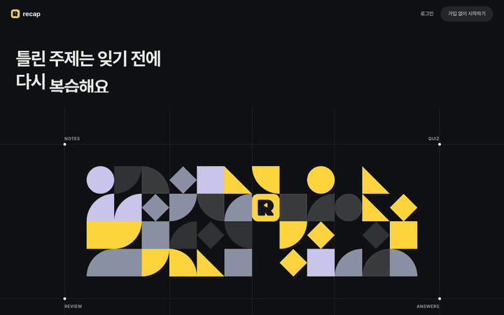
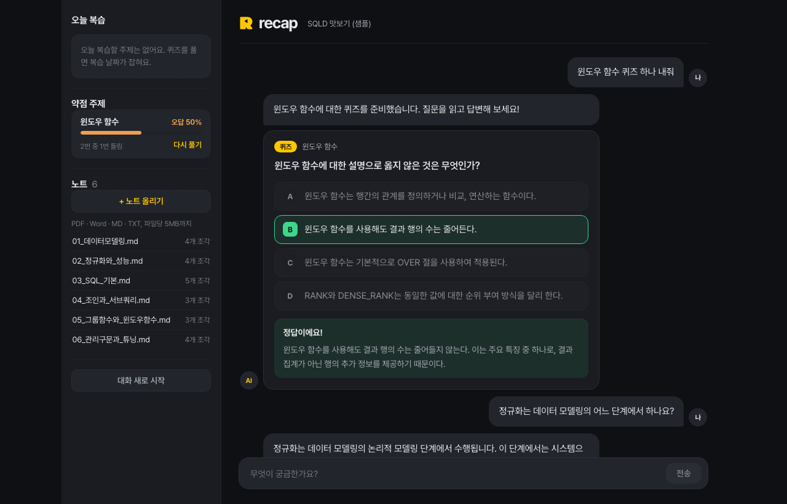
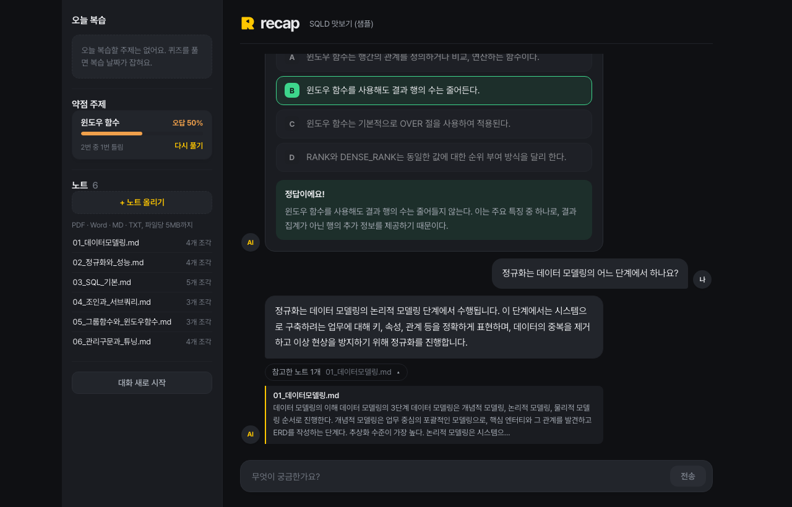
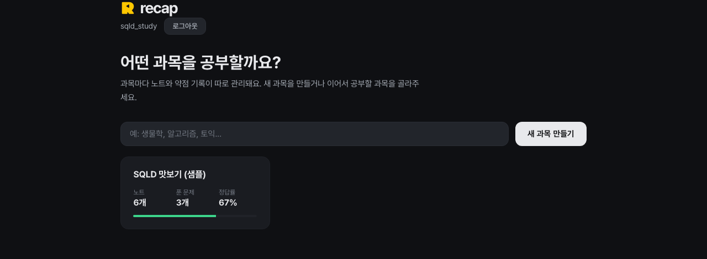
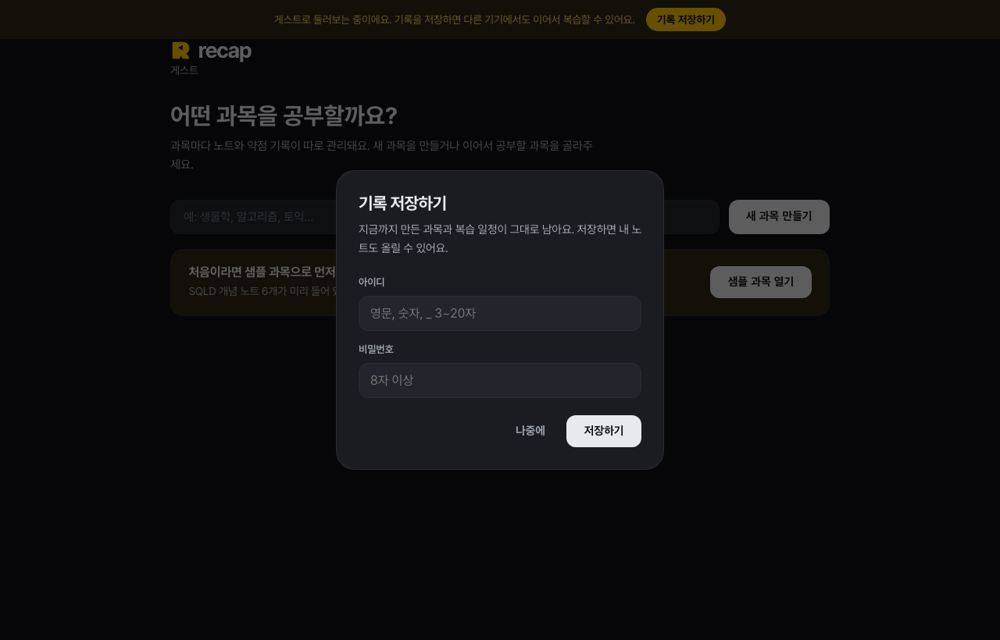
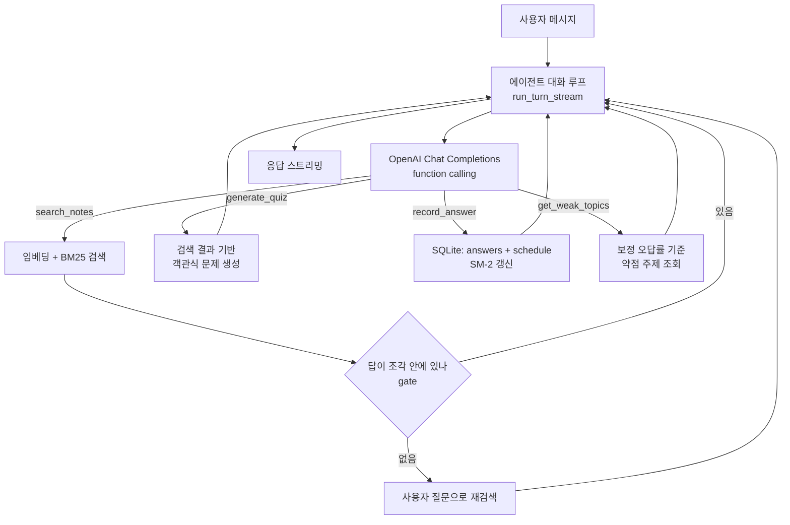
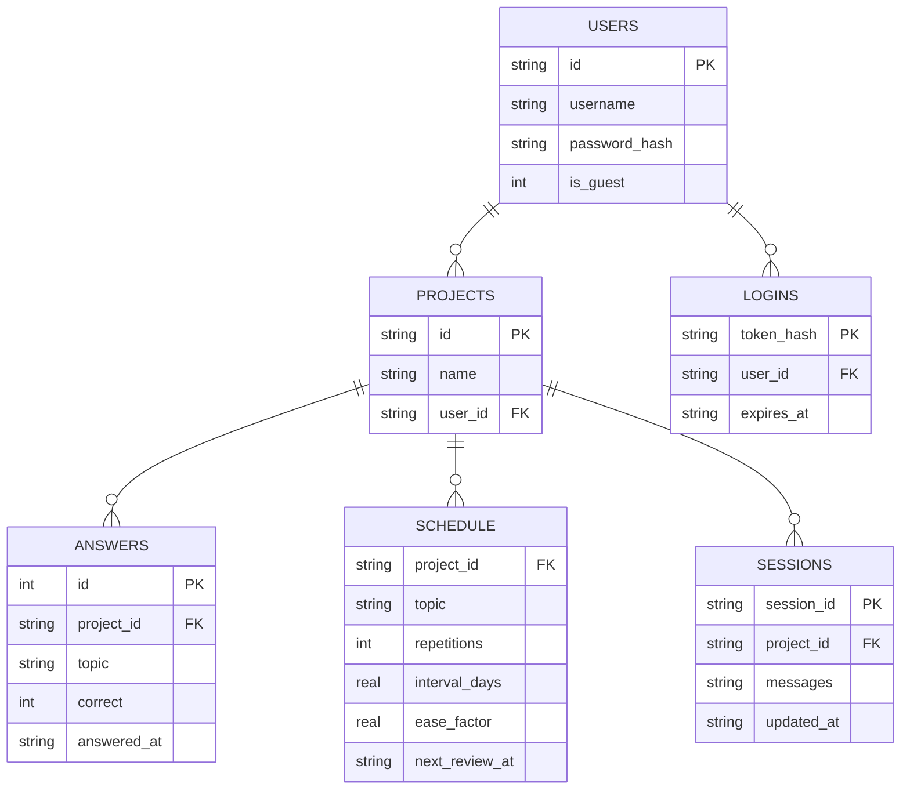

<div align="center">


# Recap

**노트를 읽고, 퀴즈를 내고, 내가 뭘 틀렸는지 기억하는 학습 에이전트**

내 노트를 검색해서 답하고, 틀린 주제를 먼저 다시 내고, SM-2로 복습 날짜를 잡습니다

[recap-study-agent.fly.dev](https://recap-study-agent.fly.dev) · 가입 없이 바로 써볼 수 있습니다


</div>

## 소개

PDF, Word, Markdown, 텍스트 노트나 웹 페이지 주소를 올리면 그 내용으로만 질문에 답하고 퀴즈를 냅니다. 퀴즈 결과는 주제별로 쌓여서, 자주 틀린 주제를 먼저 다시 내고 SM-2 간이 알고리즘으로 다음 복습 날짜를 정합니다.

과목 단위로 노트, 검색 인덱스, 학습 기록을 따로 관리합니다. 에이전트는 OpenAI function calling으로 노트 검색, 퀴즈 생성, 기록 도구를 직접 골라 호출합니다.

배포 주소에 들어가면 게스트 계정이 바로 만들어져 샘플 과목(SQLD 노트 6개)으로 써볼 수 있습니다. 아이디와 비밀번호를 정해 기록을 저장하면 같은 과목과 복습 일정이 그대로 일반 계정으로 옮겨지고, 그때부터 내 노트를 올릴 수 있습니다.

## 스크린샷



| 퀴즈 카드 | 답변과 참고한 노트 |
|---|---|
|  |  |

| 과목 목록 | 게스트 기록 저장 |
|---|---|
|  |  |

## 기능

| 기능 | 내용 |
|---|---|
| 노트 검색 | 노트를 제목 단위로 나눠 임베딩하고, 임베딩 검색과 키워드(BM25) 검색 순위를 합쳐서 찾음 (`search_notes`) |
| 답변 가능 여부 확인 | 검색한 조각에 답이 실제로 있는지 작은 모델이 먼저 읽어보고, 없으면 사용자 질문 그대로 한 번 더 검색 |
| 퀴즈 | 검색한 노트로 객관식 문제를 만들고, 보기를 누르면 서버가 정답 번호로 채점 (`generate_quiz`) |
| 약점 주제 | 정답/오답을 주제별로 기록하고, 시도 횟수를 보정한 오답률로 약점 순위 (`record_answer`, `get_weak_topics`) |
| 복습 일정 | SM-2 간이 알고리즘으로 다음 복습 날짜 계산, 과목에 들어오면 오늘 복습할 주제를 먼저 안내 |
| 근거 표시 | 답변마다 참고한 노트와 근거 문장을 보여줌 |
| 스트리밍 | SSE로 "노트를 찾고 있어요" 같은 진행 상태와 답을 글자 단위로 표시 |
| 노트 형식 | PDF, Word(.docx), Markdown, 텍스트 파일, 붙여넣은 글, 공개 웹 페이지 |
| 계정 | 회원가입·로그인, 사용자마다 과목·노트·기록 분리, 게스트로 먼저 써보고 나중에 저장 |
| 사용량 제한 | 계정별 시간당 질문 수, 업로드 크기와 개수, IP별 하루 게스트 생성 수 |

## 데이터 기준 개선

### 문제
SQLD 학습에 Recap을 2주 이상 직접 사용하던 중, 1회 시도해 1회 틀린 주제가 10회 시도해 9회 틀린 주제보다 더 큰 약점으로 정렬되는 것을 발견했습니다.

### 원인
오답률(`wrong_rate`) 계산 자체는 정확했지만, 표본 수가 다른 주제를 동일한 기준으로 비교하고 있었습니다. 시도 1회인 주제는 우연히 한 번 틀렸을 뿐이어도 오답률이 100%로 계산돼, 시도 10회 중 9회 틀린 주제(90%)보다 순위가 높아졌습니다.

### 개선
이 상황을 실패 테스트로 먼저 재현한 뒤, 시도 횟수가 적을 때는 극단적인 비율을 완화하는 보정값을 정렬 기준에 도입했습니다.

```python
adjusted_wrong_rate = (wrong + 1) / (attempts + 2)
```

화면에 보여주는 `wrong_rate`(실제 오답률)는 그대로 유지하고, 약점 주제 정렬에만 `adjusted_wrong_rate`(보정 점수)를 사용합니다.

| 주제 | 시도/오답 | wrong_rate (화면 표시) | adjusted_wrong_rate (정렬 기준) |
|---|---:|---:|---:|
| A | 1회/1회 | 100% | 66.7% |
| B | 10회/9회 | 90% | 83.3% |

보정 후에는 B가 A보다 높은 순위로 정렬됩니다.

### 검증
표본 증가, 오답 0회, 동률, 저표본 주제가 고표본 약점을 역전하지 않는지 등 경계 조건을 테스트로 추가하고, 전체 회귀 테스트와 CI로 기존 기능에 영향이 없는지 확인했습니다 (`src/tracker.py`의 `_adjusted_wrong_rate`, `tests/test_tracker.py`).

## 에이전트 동작 흐름



## 프로젝트 구조

```
study-agent/
├── server.py                  # FastAPI 앱 (API 라우트, 로그인 쿠키, 사용량 제한)
├── src/
│   ├── agent.py                # 툴 호출 대화 루프 (system prompt, run_turn, run_turn_stream)
│   ├── tools.py                 # OpenAI function-calling 스키마 + 구현
│   ├── gate.py                  # 검색한 조각으로 답할 수 있는지 판단
│   ├── refusal.py               # "노트에 없어요" 뒤에 붙는 일반 지식 설명 잘라내기
│   ├── ingest.py                # 노트 읽기(PDF·docx·MD·TXT) → 제목 단위 분할 → 임베딩 → FAISS
│   ├── webnote.py               # 공개 웹 페이지를 노트로 (사설·루프백 주소 차단)
│   ├── search.py                # FAISS 검색 + 하이브리드 순위 (프로젝트별 캐시)
│   ├── hybrid.py                # BM25와 순위 결합(RRF)
│   ├── tracker.py               # 정답/오답 기록 + SM-2 간이 복습 스케줄
│   ├── auth.py                  # 회원가입·로그인·게스트 (scrypt 해시, 세션 토큰)
│   ├── usage.py                 # 시간당 질문 수, IP별 게스트 생성 수
│   ├── display.py               # 저장된 대화 → 화면용 메시지·근거·퀴즈 카드
│   ├── quizzes.py               # 퀴즈 카드에서 고른 답 저장 (퀴즈당 한 번)
│   ├── projects.py              # 프로젝트(과목) CRUD, 사용자별 소유
│   ├── sessions.py              # 대화 세션 저장/로드
│   ├── rag_eval.py              # Hit@k, MRR, 품질 기준 비교
│   └── config.py                # pydantic-settings 기반 설정
├── frontend/                   # React (Vite) 프론트엔드
│   └── src/
│       ├── pages/                # Landing, Login, Projects, ChatApp
│       └── components/           # ChatWindow, ChatMessage, QuizCard, Sources, Sidebar, SaveProgress, Logo
├── eval/                        # RAG 품질 평가 (SQLD 노트 6개, 질문 102개, 품질 기준)
├── tests/                       # pytest (194개 테스트)
├── data/                        # SQLite DB, 프로젝트별 노트/인덱스 (gitignored)
└── .github/workflows/            # CI: ruff + pytest + 프론트 빌드 / 평가 품질 게이트
```

## 데이터 모델

SQLite(`data/tracker.db`)에 사용자, 과목, 퀴즈 답변 기록, 복습 스케줄, 대화를 저장합니다. 과목은 `user_id`로 사용자에게 속하고, 모든 API는 요청한 사용자가 그 과목의 주인인지 확인합니다. 비밀번호는 scrypt 해시로, 로그인 토큰과 게스트 생성 IP는 SHA-256 해시로만 저장합니다.



`SCHEDULE`의 PK는 `(project_id, topic)` 복합키입니다. 맞히면 반복 횟수와 간격이 늘고(1일 → 6일 → 이후 직전 간격 × ease factor, ease factor 최대 3.0), 틀리면 반복이 0으로 돌아가고 간격이 1일이 됩니다 (`src/tracker.py`의 `_next_schedule`). 게스트가 기록을 저장하면 같은 `users` 행의 아이디와 비밀번호만 바뀌므로 과목과 기록은 그대로 남습니다.

## 기술 스택

| 영역 | 기술 |
|---|---|
| Backend | Python 3.13 · FastAPI · Uvicorn |
| LLM | OpenAI `gpt-4o-mini` (답변, 퀴즈, 답변 가능 여부 확인), 평가 채점은 `gpt-4o` |
| 검색 | FAISS (`IndexFlatIP`, 코사인 유사도) + BM25, RRF로 순위 결합 |
| 임베딩 | OpenAI `text-embedding-3-small` |
| DB | SQLite |
| Frontend | React 18 · Vite · react-router-dom · Pretendard |
| 배포 | Docker · Fly.io (볼륨에 SQLite와 인덱스 저장) |
| 품질 관리 | Ruff · pytest · GitHub Actions (CI, RAG 품질 게이트) |

## 시작하기

### 사전 요구사항

- Python 3.13
- Node.js 20+
- OpenAI API 키

### 백엔드

```bash
python -m venv venv
source venv/bin/activate
pip install -r requirements.txt

cp .env.example .env
# .env에 OPENAI_API_KEY 입력

uvicorn server:app --reload
```

### 프론트엔드

```bash
cd frontend
npm install
npm run dev
```

프론트엔드는 기본적으로 `http://localhost:5173`에서 실행되고, `cors_origins` 설정으로 백엔드와 통신합니다 (`src/config.py`).

### Docker로 실행

```bash
cp .env.example .env
# .env에 OPENAI_API_KEY 입력

docker compose up --build
```

`http://localhost:8000`에서 바로 사용할 수 있습니다. 이미지 빌드 단계에서 React를 빌드하고, FastAPI가 API와 빌드된 화면을 함께 서빙합니다. 노트·FAISS 인덱스·학습 기록(`data/`)은 볼륨으로 연결돼 컨테이너를 다시 만들어도 유지됩니다.

### Fly.io 배포

Docker 이미지를 그대로 배포합니다. SQLite와 FAISS 인덱스가 있는 `/app/data`에 볼륨을 붙여 재배포해도 데이터가 남습니다 (`fly.toml`).

```bash
fly launch --no-deploy --copy-config        # 앱 이름은 fly.toml의 app 값
fly volumes create recap_data --size 1 --region nrt
fly secrets set OPENAI_API_KEY=...
fly deploy
```

공개 주소에서 OpenAI 비용이 새지 않도록 여러 단계로 막습니다.

| 설정 | 기본값 | 내용 |
|---|---:|---|
| `CHAT_LIMIT_PER_HOUR` | 30 | 저장된 계정의 시간당 질문 수 |
| `GUEST_CHAT_LIMIT_PER_HOUR` | 10 | 게스트의 시간당 질문 수 |
| `GUEST_LIMIT_PER_IP_PER_DAY` | 5 | 한 IP에서 하루에 만들 수 있는 게스트 수 (쿠키를 지워 새 게스트를 만드는 우회 방지) |
| `GUEST_ENABLED` | true | 끄면 가입한 사람만 사용 |
| `SIGNUP_CODE` | 없음 | 설정하면 이 코드를 아는 사람만 가입·기록 저장 가능 |
| `MAX_UPLOAD_MB`, `MAX_NOTES_PER_PROJECT` | 5, 20 | 업로드 크기와 과목당 노트 수 |

게스트는 노트를 올릴 수 없고, 기록을 저장한 뒤부터 올릴 수 있습니다. 로그인 쿠키는 HttpOnly·SameSite=Lax이고 Fly에서는 HTTPS 전용(`COOKIE_SECURE`)입니다. 이 제한과 별개로 OpenAI 대시보드의 월 사용 한도도 함께 걸어두는 것을 권장합니다.

계정 기능 이전에 만든 과목은 주인이 없어 아무에게도 보이지 않습니다. 가입한 뒤 `python -m src.auth claim <아이디>`로 내 계정에 옮길 수 있습니다 (Fly에서는 `fly ssh console -C "python -m src.auth claim <아이디>"`). 사이트 전체를 비밀번호 하나로 잠그는 `ACCESS_PASSWORD`(HTTP Basic)도 쓸 수 있습니다.

### 노트 색인 (CLI)

```bash
python -m src.ingest <project_id>
```

`data/projects/<project_id>/notes/`에 노트 파일을 넣고 실행하면 FAISS 인덱스가 생성됩니다. 화면이나 API로 올리면 자동으로 색인됩니다. 이미 임베딩한 조각은 캐시(`embeddings.npz`)에서 다시 쓰므로, 노트를 하나 추가하면 그 노트만 새로 임베딩합니다.

## API

| Method | Endpoint | 설명 |
|---|---|---|
| GET | `/api/health` | 헬스체크 (인증 없이 접근 가능) |
| POST | `/api/auth/signup` · `/api/auth/login` · `/api/auth/logout` | 회원가입·로그인(세션 쿠키 발급)·로그아웃 |
| POST | `/api/auth/guest` | 게스트로 시작 (이미 로그인돼 있으면 그 계정을 그대로 반환) |
| POST | `/api/auth/upgrade` | 게스트 기록 저장 (아이디·비밀번호 지정) |
| GET | `/api/auth/me` · `/api/auth/config` | 로그인한 사용자, 가입 코드 필요 여부 |
| POST | `/api/projects` | 과목 생성 |
| GET | `/api/projects` | 과목 목록 (노트 수, 푼 문제, 정답률, 복습 예정 수) |
| POST | `/api/projects/sample` | 샘플 과목 만들기 |
| POST | `/api/session` | 대화 세션 생성 또는 마지막 대화 이어보기 (복습 예정 주제가 있으면 먼저 안내) |
| POST | `/api/chat` | 메시지 전송, 에이전트 턴 실행 |
| POST | `/api/chat/stream` | 같은 턴을 SSE로 스트리밍 (`status`·`delta`·`done`·`error` 이벤트) |
| POST | `/api/quiz/answer` | 퀴즈 카드에서 고른 보기 채점, 약점·복습 기록 |
| GET | `/api/review` | 오늘 복습할 주제 |
| GET | `/api/weak-topics` | 보정 오답률 기준 약점 주제 |
| POST | `/api/reset` | 대화 초기화 |
| GET | `/api/notes` | 과목의 노트 파일과 조각 수 |
| POST | `/api/notes` | 노트 파일 업로드 (PDF·docx·MD·TXT) 후 자동 색인 |
| POST | `/api/notes/text` · `/api/notes/url` | 붙여넣은 글, 공개 웹 페이지를 노트로 추가 |

## RAG 품질 평가

검색과 답변 품질을 감이 아니라 숫자로 보려고 고정 평가셋을 만들었습니다 (`eval/`).

- **코퍼스**: SQLD 개념 노트 6개 (데이터 모델링, 정규화, SQL 기본, 조인·서브쿼리, 윈도우 함수, 인덱스·튜닝, 약 1.1만 자)
- **질문 102개**
  - 노트에 답이 있는 질문 56개
  - 같은 내용을 노트와 다른 말로 물은 질문 26개 (예: "비트맵 인덱스"를 "남녀처럼 값 종류가 몇 개 안 되는 열에 어울리는 색인")
  - 노트에 없는 질문 20개 (CONCAT은 있지만 LISTAGG는 없는 것처럼 주변 내용만 다루는 함정 질문 포함)
- **정답 라벨**: 질문마다 노트의 근거 구절을 지정합니다. 검색된 조각에 그 구절이 들어 있으면 맞게 찾은 것으로 보므로, 조각 크기를 바꿔도 라벨을 다시 만들 필요가 없습니다.
- **채점**: 답변은 에이전트(`gpt-4o-mini`)와 다른 모델인 `gpt-4o`가 채점합니다. 같은 답을 에이전트 모델로도 채점해서 두 채점이 얼마나 다른지 함께 기록합니다.

```bash
python -m eval.run_eval                                # 검색 평가: 조각 300/500/800, 검색 방식별 비교
python -m eval.run_eval --answers --repeats 2          # 실제 에이전트(run_turn_stream) 답변까지 평가
python -m eval.run_eval --answers --ids p08 p25        # 특정 질문만 다시 확인
python -m eval.run_eval --answers --gate               # eval/gates.json 기준 미달이면 exit 1
```

### 검색: 말을 바꾼 질문에서 임베딩 검색이 약했음

노트와 다른 말로 묻는 질문 26개를 추가하자, 임베딩 검색만으로는 정답 조각이 상위 5개에 드는 비율이 86.6%까지 떨어졌습니다. 반대로 키워드 검색(BM25)은 NTILE이나 힌트 문법처럼 드문 용어에 강했습니다. 두 순위를 RRF로 합치고(임베딩 1 : 키워드 2), 노트를 제목 단위로 나눠 제목과 그 아래 설명이 한 조각에 같이 들어가게 했습니다.

| 검색 방식 (조각 800, 답이 있는 82문항) | Hit@1 | Hit@5 | MRR |
|---|---:|---:|---:|
| 임베딩 | 73.2% | 86.6% | 0.799 |
| 키워드(BM25) | 86.6% | 96.3% | 0.909 |
| **하이브리드 (현재)** | **89.0%** | **97.6%** | **0.920** |

가중치는 1:1, 1:2, 1:3을 비교해 말을 바꾼 질문에서 가장 나은 1:2로 정했습니다. 조각 크기는 300과 500에서 하이브리드 Hit@5가 96.3%로, 800(97.6%)을 유지했습니다.

### 답변: 노트에 없는 질문을 확실히 거절하게

검색은 항상 가장 가까운 조각을 돌려주기 때문에, 노트에 없는 질문에도 비슷한 분야의 조각이 높은 점수로 나옵니다. 유사도 점수로는 "말이 비슷한 것"과 "답이 들어 있는 것"을 구분할 수 없어서, 검색 결과를 작은 모델이 직접 읽고 답이 있는지 판단하게 했습니다(`src/gate.py`). 답이 없다고 나오면 사용자가 쓴 질문 그대로 한 번 더 검색합니다.

| 버전 (102문항, 2회 실행, `gpt-4o` 채점) | 정확도 | 노트 밖 질문 거절률 | 잘못된 거절 | 첫 반응 p50 | 첫 글자 p50 |
|---|---:|---:|---:|---:|---:|
| 확인 단계 없음 | 95.7% | 92.5% | 4.3% | 0.79초 | 2.04초 |
| 확인 단계 추가 | 91.5% | 100% | 7.3% | 0.74초 | 2.65초 |
| **재검색 판단을 사용자 질문 기준으로 (현재)** | **94.5%** | **100%** | **3.7%** | **0.74초** | **2.69초** |

처음 넣었을 때는 노트 밖 질문은 모두 거절했지만, 답이 있는 질문까지 거절하는 경우가 4.3%에서 7.3%로 늘었습니다. 틀린 문항을 다시 보니 재검색 결과를 모델이 만든 키워드 검색어 기준으로 판단하고 있었습니다. 그 검색어는 이미 한 번 놓친 검색어라 같은 판단이 반복됐습니다. 사용자의 원래 질문 기준으로 판단하게 바꾸자 p08(교차 조인 결과 행 수), p09, p25(비트맵 인덱스)가 거절에서 정답으로 바뀌었습니다.

확인 단계에 모델 호출이 하나 더 들어가서 첫 글자가 나오기까지 약 0.6초 늘었습니다. 진행 상태("노트를 찾고 있어요")는 그대로 0.7초대에 보여서, 기다리는 동안 화면이 멈춰 있지는 않습니다.

채점 모델을 에이전트와 같은 `gpt-4o-mini`에서 `gpt-4o`로 바꾼 뒤, 두 모델 채점이 갈린 비율은 첫 측정에서 4.9%였습니다. 지금 버전에서는 0.5%로, 숫자가 채점 모델에 크게 좌우되지 않는 상태입니다.

### 처음 평가셋 기록 (38문항, 같은 모델이 채점)

| 지표 | 값 |
|---|---:|
| 검색 Hit@5 (임베딩만) | 100% (32/32) |
| 정확도 | 96.9% (31/32) |
| 노트에 없는 질문 거절률 | 100% (6/6) |
| 응답 시간 p50 | 2.55초 |

질문이 적고 노트 문장과 비슷하게 물어서 숫자가 높게 나왔습니다. 노트 밖 질문 6개로는 한 문항이 17%p를 움직여서, 질문을 늘리고 말을 바꾼 질문을 넣은 뒤로는 위의 102문항 결과를 기준으로 봅니다.

### 품질 게이트 (CI)

프롬프트, 도구, 검색 코드나 평가셋이 바뀌면 GitHub Actions(`.github/workflows/eval.yml`)가 실제 에이전트로 평가를 돌리고 `eval/gates.json` 기준에 못 미치면 실패합니다. 한 번에 몇 센트가 들기 때문에 관련 파일이 바뀔 때와 수동 실행 때만 돌고, `OPENAI_API_KEY` 시크릿이 없으면 건너뜁니다.

| 기준 | 값 | 이유 |
|---|---:|---|
| Hit@5 (조각 800) | ≥ 92% | 검색은 실행마다 같아서 여유를 작게 둠 |
| 정확도 | ≥ 90% | 현재 94.5% |
| 노트 밖 질문 거절률 | ≥ 75% | 프롬프트가 망가졌을 때의 33% 같은 회귀를 확실히 잡음 |
| 잘못된 거절 | ≤ 5% | 거절 규칙을 세게 걸었을 때의 과잉 거절(6~9%)을 잡음 |

## UX 개선

직접 써보면서 불편한 지점을 찾고, 고친 뒤 같은 평가셋으로 다시 측정했습니다.

| 발견한 문제 | 바꾼 것 |
|---|---|
| 퀴즈 답을 "2번"처럼 글로 쓰고, LLM이 그 글을 해석해 채점 | 보기를 누르는 퀴즈 카드, 서버가 정답 번호로 채점 |
| 답이 다 만들어질 때까지 2.5초 동안 빈 화면 | SSE 스트리밍 + "노트를 찾고 있어요" 같은 진행 상태 |
| 답이 어느 노트에서 왔는지 알 수 없음 | 답변 아래 "참고한 노트"와 근거 조각 |
| 새 계정은 빈 화면에서 시작 | 샘플 과목 버튼, 노트가 없을 때 3단계 안내 |
| 약점이 "general" 하나로 뭉침 | 퀴즈 주제를 구체적인 개념 이름으로, 약점마다 "다시 풀기" |
| 과목에 다시 들어오면 대화가 사라짐 | 마지막 대화 이어보기 |
| 노트에 없다고 해놓고 "일반적으로는…" 설명을 덧붙임 | 거절 문장 뒤의 설명은 잘라내고 노트를 올려달라는 안내로 마무리 |
| 써보려면 먼저 가입해야 함 | 게스트로 바로 시작, 마음에 들면 기록 저장 |

### 전후 측정 (처음 평가셋: 답이 있는 질문 32개 + 노트에 없는 질문 6개)

| 버전 | 정확도 | 노트 밖 질문 거절률 | 잘못된 거절 | 첫 반응 p50 | 첫 글자 p50 |
|---|---:|---:|---:|---:|---:|
| 개선 전 (스트리밍 없음) | 96.9% | 100% | 0% | 2.55초 | 2.55초 |
| 개선 1차 프롬프트 | 100% | 33% | 0% | 0.88초 | 1.74초 |
| 거절 규칙 강화 (2회 평균) | 90.6% | 100% | 7.8% | 0.86초 | 1.76초 |
| 재검색 후 판단 (2회 평균) | 96.9% | 91.7% | 0% | 0.79초 | 1.84초 |

첫 반응은 진행 상태나 첫 글자 중 먼저 보이는 것까지의 시간입니다. 개선 전에는 답이 다 만들어져야 화면이 바뀌었기 때문에 전체 응답 시간과 같습니다.

**프롬프트 회귀**: 퀴즈 카드 안내를 프롬프트에 추가했더니 "노트에 없으면 모른다고 하라"는 규칙이 약해져, 노트 밖 질문에 "찾지 못했지만 일반적으로는…"이라고 답하는 비율이 크게 늘었습니다(거절률 100% → 33%). 규칙을 세게 걸자 이번엔 답이 있는 질문에도 거절하는 과잉 거절이 생겨, "관련 문장이 있으면 그것으로 답하고, 없어 보이면 다른 표현으로 한 번 더 검색한 뒤 판단"하도록 바꿔 균형을 맞췄습니다. 이 경험이 위의 품질 게이트와 답변 가능 여부 확인 단계로 이어졌습니다.

## 테스트와 CI

```bash
ruff check .
pytest -q
```

pytest 194개로 다음을 검증합니다 (`tests/`, 17개 모듈).

- 약점 주제 순위·보정 점수, SM-2 복습 간격
- 하이브리드 검색 순위, 답변 가능 여부 확인과 재검색, 거절 뒤 설명 잘라내기
- 노트 분할, docx와 웹 페이지 노트
- 과목별 노트·기록 분리, 대화 세션
- 회원가입·로그인·게스트 저장, 사용자 간 데이터 격리, 사용량·게스트 생성 제한
- 퀴즈 카드 채점, 스트리밍 이벤트, RAG 평가 지표 계산

`main` 브랜치 push와 PR마다 GitHub Actions에서 Ruff, pytest, 프론트엔드 빌드를 확인합니다.

## 상태

노트 검색, 퀴즈 카드, 약점 기록, SM-2 복습, 계정과 게스트, 스트리밍까지 만들어 Fly.io에 배포했습니다.
