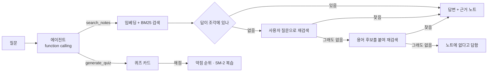

<div align="center">


# Recap

**노트를 읽고, 퀴즈를 내고, 내가 뭘 틀렸는지 기억하는 학습 에이전트**

내 노트를 검색해서 답하고, 틀린 주제를 먼저 다시 내고, SM-2로 복습 날짜를 잡습니다

[](https://recap-study-agent.fly.dev)


</div>

## 한눈에 보기

| 검색 Hit@5 | 답변 정확도 | 노트 밖 질문 거절 | 잘못된 거절 |
|:---:|:---:|:---:|:---:|
| **97.6%** | **97.6%** | **100%** | **1.2%** |

SQLD 노트 6개 · 질문 102개 · 에이전트 `gpt-4o-mini` · 채점 `gpt-4o` · 2회 실행

## 소개

- PDF · Word · Markdown · 텍스트 노트나 웹 페이지 주소를 올리면, 그 내용으로만 질문에 답하고 퀴즈 출제
- 퀴즈 결과를 주제별로 쌓아 자주 틀린 주제를 먼저 출제, SM-2로 복습 날짜 결정
- 배포 주소에서 게스트로 바로 체험 (샘플 과목 SQLD 노트 6개), 기록을 저장하면 계정으로 이전


| 퀴즈 카드 | 답변과 참고한 노트 |
|---|---|
|  |  |

## 동작 방식



- 답변마다 참고한 노트와 근거 문장을 보여주고, 노트에 없는 내용은 모른다고 답합니다.
- 과목마다 노트, 인덱스, 기록이 분리되고, 사용자 간 데이터는 서버에서 소유자를 확인해 막습니다.

## 검색

- 말을 바꾼 질문에서 임베딩 검색만으로는 Hit@5 86.6%
- 키워드 검색(BM25)과 RRF로 합쳐 97.6% (평가셋: SQLD 노트 6개, 질문 102개, 질문마다 근거 구절 라벨)

| 검색 방식 (답이 있는 82문항) | Hit@1 | Hit@5 | MRR |
|---|---:|---:|---:|
| 임베딩 | 73.2% | 86.6% | 0.799 |
| 키워드(BM25) | 86.6% | 96.3% | 0.909 |
| **하이브리드 (현재)** | **89.0%** | **97.6%** | **0.920** |

## 답변

- 검색 결과를 작은 모델이 읽고 답이 있는지 판단하는 확인 단계 (`src/gate.py`)
- 노트 밖 질문 거절 100%, 늘어난 잘못된 거절은 재검색 기준을 사용자 질문으로 바꿔 7.3% → 3.7%
- 이후 개선: 정확도 97.6%, 잘못된 거절 1.2% ([다른 과목으로 검증](#다른-과목으로-검증))

| 버전 (102문항, 2회 실행, `gpt-4o` 채점) | 정확도 | 노트 밖 질문 거절률 | 잘못된 거절 | 첫 글자 p50 |
|---|---:|---:|---:|---:|
| 확인 단계 없음 | 95.7% | 92.5% | 4.3% | 2.04초 |
| 확인 단계 추가 | 91.5% | 100% | 7.3% | 2.65초 |
| **재검색 판단을 사용자 질문 기준으로** | **94.5%** | **100%** | **3.7%** | **2.69초** |

## 다른 과목으로 검증

- SQLD로 정한 설정을 정보처리기사 노트 6개로 검증 (질문은 측정 전에 커밋으로 고정)
- 노트 단어와 겹치지 않는 질문에서 약점 발견 → 검색 순위 결합 · 확인 단계 수정 ([과정](docs/eval-history.md#처음-보는-과목으로-검증))

| 노트 단어 겹침 35% 미만 질문 | 검색 Hit@5 | 정확도 | 잘못된 거절 |
|---|---:|---:|---:|
| 개발용 16문항, 수정 전 | 75.0% | 75.0% | 18.8% |
| 개발용 16문항, 수정 후 | 87.5% | 78.1% | 12.5% |
| **최종 16문항 (수정 전에 고정, 1회 측정)** | **100%** | **87.5%** | **12.5%** |

| SQLD 102문항 | 정확도 | 노트 밖 질문 거절률 | 잘못된 거절 | 첫 글자 p50 |
|---|---:|---:|---:|---:|
| 검색 수정 전 | 94.5% | 100% | 3.7% | 2.69초 |
| 검색 수정 후 | 96.3% | 95.0% | 2.4% | 2.92초 |
| **확인 단계 수정 후** | **97.6%** | **100%** | **1.2%** | 3.66초 |

## 질의 확장

- 확인 단계를 통과하지 못한 질문에만 교과서 용어 후보를 붙여 재검색 (`src/expand.py`), 평소 응답에는 영향 없음
- 묘사형 질문 40개 중 2건 회복, 노트 밖 질문 36개는 모두 차단 유지 (묘사형 24개는 코드 작성 전 고정)

| 질문 묶음 | 확장 전 | 확장 후 |
|---|---:|---:|
| 묘사형 SQLD (12) | 12/12 | 12/12 |
| 묘사형 정보처리기사 (12) | 10/12 | 11/12 |
| 말 바꾼 개발용 정보처리기사 (16) | 14/16 | 15/16 |
| 노트 밖 질문 36개 (SQLD 20, 정보처리기사 16) | 36/36 차단 | 36/36 차단 |

## 한계와 다음 단계

- 평가 질문이 과목당 수십 개라 1문항이 1~3%p, 과목은 SQLD · 정보처리기사 둘
- 질문이 가리키는 용어를 노트와 연결하지 못하는 경우 남음 (예: 살충제 패러독스, 스텁)
- 확인 단계가 추론이 필요한 연결을 거절하는 경우 있음
- 첫 글자까지 p50 3.66초, 단축이 다음 과제

## 기술 스택

| 영역 | 기술 |
|---|---|
| Backend | Python 3.13 · FastAPI · SQLite |
| LLM | OpenAI `gpt-4o-mini` (답변, 퀴즈, 답변 가능 여부 확인), 평가 채점 `gpt-4o` |
| 검색 | FAISS + BM25 (RRF), 임베딩 `text-embedding-3-small` |
| Frontend | React 18 · Vite |
| 배포·품질 | Docker · Fly.io · Ruff · pytest 219개 · GitHub Actions |

## 실행

```bash
python -m venv venv && source venv/bin/activate
pip install -r requirements.txt
cp .env.example .env            # OPENAI_API_KEY 입력
uvicorn server:app --reload
```

```bash
cd frontend && npm install && npm run dev
```

## 더 보기

- [구조와 데이터 모델](docs/architecture.md): 파일 구조, ER 다이어그램, API 목록
- [실행과 배포](docs/deployment.md): Docker, Fly.io, 비용 제한 설정
- [평가 기록과 UX 측정](docs/eval-history.md): 다른 과목 검증 과정, 처음 38문항 결과, 스트리밍 전후 측정, 품질 게이트 기준
