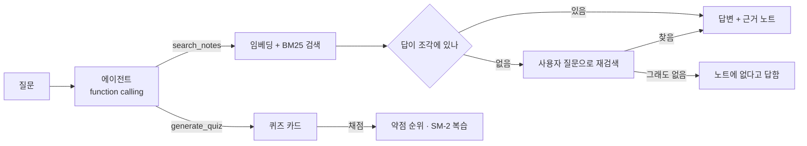

<div align="center">


# Recap

**노트를 읽고, 퀴즈를 내고, 내가 뭘 틀렸는지 기억하는 학습 에이전트**

내 노트를 검색해서 답하고, 틀린 주제를 먼저 다시 내고, SM-2로 복습 날짜를 잡습니다

[recap-study-agent.fly.dev](https://recap-study-agent.fly.dev) · 가입 없이 바로 써볼 수 있습니다


</div>

## 소개

PDF, Word, Markdown, 텍스트 노트나 웹 페이지 주소를 올리면 그 내용으로만 질문에 답하고 퀴즈를 냅니다. 퀴즈 결과는 주제별로 쌓여서, 자주 틀린 주제를 먼저 다시 내고 다음 복습 날짜를 정합니다.

배포 주소에 들어가면 게스트로 바로 샘플 과목(SQLD 노트 6개)을 써볼 수 있고, 기록을 저장하면 같은 과목과 복습 일정이 그대로 계정으로 옮겨집니다.


| 퀴즈 카드 | 답변과 참고한 노트 |
|---|---|
|  |  |

| 과목 목록 | 게스트 기록 저장 |
|---|---|
|  |  |

## 동작 방식



- 에이전트가 노트 검색, 퀴즈 생성, 기록 도구를 직접 골라 호출합니다.
- 답변마다 참고한 노트와 근거 문장을 보여주고, 노트에 없는 내용은 모른다고 답합니다.
- 퀴즈는 보기를 누르면 서버가 정답 번호로 채점하고, 결과가 약점 순위와 복습 일정에 반영됩니다.
- 과목마다 노트, 인덱스, 기록이 분리되고, 사용자 간 데이터는 서버에서 소유자를 확인해 막습니다.

## 검색 품질: 말을 바꾼 질문에서 임베딩 검색이 약했음

검색과 답변 품질을 숫자로 보려고 고정 평가셋을 만들었습니다. SQLD 노트 6개에 질문 102개(답이 있는 질문 56개, 같은 내용을 노트와 다른 말로 물은 질문 26개, 노트에 없는 질문 20개)이고, 질문마다 노트의 근거 구절을 정답 라벨로 붙였습니다.

말을 바꾼 질문(예: "비트맵 인덱스"를 "남녀처럼 값 종류가 몇 개 안 되는 열에 어울리는 색인"으로)을 넣자, 임베딩 검색만으로는 정답 조각이 상위 5개에 드는 비율이 86.6%였습니다. 키워드 검색(BM25)은 NTILE이나 힌트 문법처럼 드문 용어에 강해서, 두 순위를 RRF로 합치고(임베딩 1 : 키워드 2) 노트를 제목 단위로 나눴습니다.

| 검색 방식 (답이 있는 82문항) | Hit@1 | Hit@5 | MRR |
|---|---:|---:|---:|
| 임베딩 | 73.2% | 86.6% | 0.799 |
| 키워드(BM25) | 86.6% | 96.3% | 0.909 |
| **하이브리드 (현재)** | **89.0%** | **97.6%** | **0.920** |

## 답변 품질: 노트에 없는 질문을 확실히 거절하게

검색은 항상 가장 가까운 조각을 돌려주기 때문에 노트에 없는 질문에도 비슷한 분야의 조각이 높은 점수로 나옵니다. 유사도 점수로는 "말이 비슷한 것"과 "답이 들어 있는 것"을 구분할 수 없어서, 검색 결과를 작은 모델이 직접 읽고 답이 있는지 판단하게 했습니다(`src/gate.py`).

| 버전 (102문항, 2회 실행, `gpt-4o` 채점) | 정확도 | 노트 밖 질문 거절률 | 잘못된 거절 | 첫 글자 p50 |
|---|---:|---:|---:|---:|
| 확인 단계 없음 | 95.7% | 92.5% | 4.3% | 2.04초 |
| 확인 단계 추가 | 91.5% | 100% | 7.3% | 2.65초 |
| **재검색 판단을 사용자 질문 기준으로 (현재)** | **94.5%** | **100%** | **3.7%** | **2.69초** |

처음 넣었을 때는 노트 밖 질문을 모두 거절했지만, 답이 있는 질문까지 거절하는 경우가 4.3%에서 7.3%로 늘었습니다. 틀린 문항을 보니 재검색 결과를 모델이 만든 키워드 검색어 기준으로 판단하고 있었고, 그 검색어는 이미 한 번 놓친 검색어였습니다. 사용자의 원래 질문 기준으로 바꾸자 교차 조인 결과 행 수, 비트맵 인덱스 같은 문항이 거절에서 정답으로 바뀌었습니다.

확인 단계 때문에 첫 글자까지 약 0.6초 늘었지만, "노트를 찾고 있어요" 같은 진행 상태는 0.7초대에 보여서 화면이 멈춰 있지는 않습니다. 답변은 에이전트(`gpt-4o-mini`)와 다른 모델이 채점하고, 이 기준들은 CI 품질 게이트로 걸어 회귀를 막습니다.

## 약점 순위: 시도 횟수가 다른 주제를 같은 기준으로 비교하던 문제

SQLD 공부에 2주 넘게 직접 쓰다가, 1번 풀어 1번 틀린 주제가 10번 풀어 9번 틀린 주제보다 더 큰 약점으로 정렬되는 것을 발견했습니다. 오답률 계산은 맞았지만 시도 1회짜리는 우연히 한 번 틀려도 100%가 됐습니다.

실패 테스트로 먼저 재현한 뒤, 정렬에만 시도 횟수를 보정한 점수를 쓰고 화면에는 실제 오답률을 그대로 보여주도록 했습니다.

```python
adjusted_wrong_rate = (wrong + 1) / (attempts + 2)
```

| 주제 | 시도/오답 | 화면 표시 오답률 | 정렬 기준 |
|---|---:|---:|---:|
| A | 1회/1회 | 100% | 66.7% |
| B | 10회/9회 | 90% | 83.3% |

## 써보면서 고친 것

| 발견한 문제 | 바꾼 것 |
|---|---|
| 퀴즈 답을 "2번"처럼 글로 쓰고, LLM이 그 글을 해석해 채점 | 보기를 누르는 퀴즈 카드, 서버가 정답 번호로 채점 |
| 답이 다 만들어질 때까지 2.5초 동안 빈 화면 | SSE 스트리밍, 진행 상태가 0.8초 안에 보임 |
| 답이 어느 노트에서 왔는지 알 수 없음 | 답변 아래 참고한 노트와 근거 문장 |
| 노트에 없다고 해놓고 "일반적으로는…" 설명을 덧붙임 | 거절 문장 뒤의 설명은 잘라내고 노트를 올려달라는 안내로 마무리 |
| 약점이 "general" 하나로 뭉침 | 퀴즈 주제를 구체적인 개념 이름으로, 약점마다 "다시 풀기" |
| 써보려면 먼저 가입해야 함 | 게스트로 바로 시작, 마음에 들면 기록 저장 |

## 기술 스택

| 영역 | 기술 |
|---|---|
| Backend | Python 3.13 · FastAPI · SQLite |
| LLM | OpenAI `gpt-4o-mini` (답변, 퀴즈, 답변 가능 여부 확인), 평가 채점 `gpt-4o` |
| 검색 | FAISS + BM25 (RRF), 임베딩 `text-embedding-3-small` |
| Frontend | React 18 · Vite |
| 배포·품질 | Docker · Fly.io · Ruff · pytest 194개 · GitHub Actions |

## 실행

```bash
python -m venv venv && source venv/bin/activate
pip install -r requirements.txt
cp .env.example .env            # OPENAI_API_KEY 입력
uvicorn server:app --reload
```

```bash
cd frontend && npm install && npm run dev
```

Docker로 한 번에 띄우려면 `docker compose up --build` 후 `http://localhost:8000`을 열면 됩니다. API 문서는 서버의 `/docs`에서 볼 수 있습니다.

## 더 보기

- [구조와 데이터 모델](docs/architecture.md): 파일 구조, ER 다이어그램, API 목록
- [실행과 배포](docs/deployment.md): Docker, Fly.io, 비용 제한 설정
- [평가 기록과 UX 측정](docs/eval-history.md): 처음 38문항 결과, 스트리밍 전후 측정, 품질 게이트 기준
