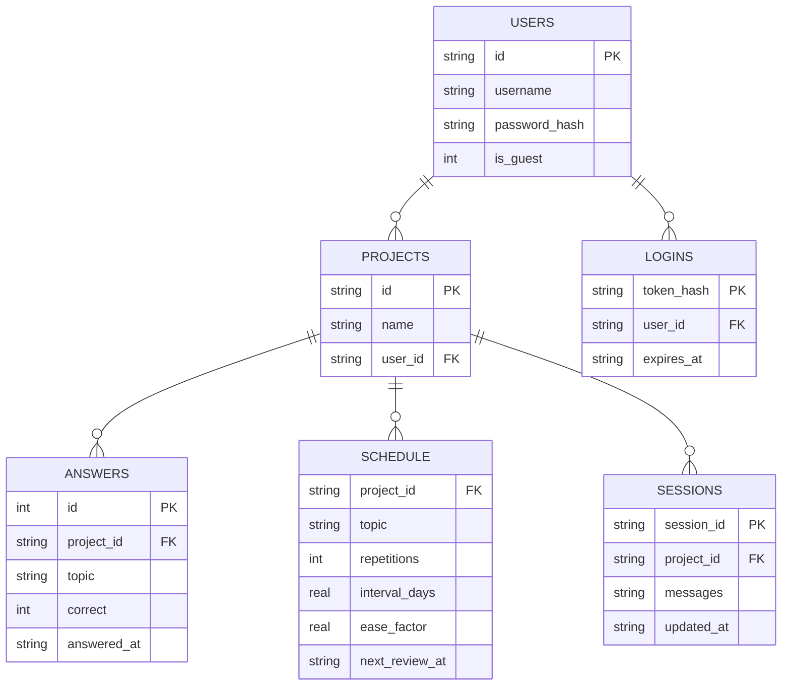

# 구조와 데이터 모델

## 프로젝트 구조

```
study-agent/
├── server.py                  # FastAPI 앱 (API 라우트, 로그인 쿠키, 사용량 제한)
├── src/
│   ├── agent.py                # 툴 호출 대화 루프 (system prompt, run_turn, run_turn_stream)
│   ├── tools.py                 # OpenAI function-calling 스키마 + 구현
│   ├── gate.py                  # 검색한 조각으로 답할 수 있는지 판단
│   ├── refusal.py               # "노트에 없어요" 뒤에 붙는 일반 지식 설명 잘라내기
│   ├── ingest.py                # 노트 읽기(PDF·docx·MD·TXT) → 제목 단위 분할 → 임베딩 → FAISS
│   ├── webnote.py               # 공개 웹 페이지를 노트로 (사설·루프백 주소 차단)
│   ├── search.py                # FAISS 검색 + 하이브리드 순위 (프로젝트별 캐시)
│   ├── hybrid.py                # BM25와 순위 결합(RRF)
│   ├── tracker.py               # 정답/오답 기록 + SM-2 간이 복습 스케줄
│   ├── auth.py                  # 회원가입·로그인·게스트 (scrypt 해시, 세션 토큰)
│   ├── usage.py                 # 시간당 질문 수, IP별 게스트 생성 수
│   ├── display.py               # 저장된 대화 → 화면용 메시지·근거·퀴즈 카드
│   ├── quizzes.py               # 퀴즈 카드에서 고른 답 저장 (퀴즈당 한 번)
│   ├── projects.py              # 프로젝트(과목) CRUD, 사용자별 소유
│   ├── sessions.py              # 대화 세션 저장/로드
│   ├── rag_eval.py              # Hit@k, MRR, 품질 기준 비교
│   └── config.py                # pydantic-settings 기반 설정
├── frontend/                   # React (Vite) 프론트엔드
│   └── src/
│       ├── pages/                # Landing, Login, Projects, ChatApp
│       └── components/           # ChatWindow, ChatMessage, QuizCard, Sources, Sidebar, SaveProgress, Logo
├── eval/                        # RAG 품질 평가 (SQLD 노트 6개, 질문 102개, 품질 기준)
├── tests/                       # pytest (194개 테스트, 17개 모듈)
├── data/                        # SQLite DB, 프로젝트별 노트/인덱스 (gitignored)
└── .github/workflows/            # CI: ruff + pytest + 프론트 빌드 / 평가 품질 게이트
```

## 데이터 모델

SQLite(`data/tracker.db`)에 사용자, 과목, 퀴즈 답변 기록, 복습 스케줄, 대화를 저장합니다. 과목은 `user_id`로 사용자에게 속하고, 모든 API는 요청한 사용자가 그 과목의 주인인지 확인합니다. 비밀번호는 scrypt 해시로, 로그인 토큰과 게스트 생성 IP는 SHA-256 해시로만 저장합니다.



`SCHEDULE`의 PK는 `(project_id, topic)` 복합키입니다. 맞히면 반복 횟수와 간격이 늘고(1일 → 6일 → 이후 직전 간격 × ease factor, ease factor 최대 3.0), 틀리면 반복이 0으로 돌아가고 간격이 1일이 됩니다 (`src/tracker.py`의 `_next_schedule`). 게스트가 기록을 저장하면 같은 `users` 행의 아이디와 비밀번호만 바뀌므로 과목과 기록은 그대로 남습니다.

## API

서버를 띄우면 `/docs`에서 요청·응답 형식까지 볼 수 있습니다 ([배포 서버의 API 문서](https://recap-study-agent.fly.dev/docs)).

| Method | Endpoint | 설명 |
|---|---|---|
| GET | `/api/health` | 헬스체크 (인증 없이 접근 가능) |
| POST | `/api/auth/signup` · `/api/auth/login` · `/api/auth/logout` | 회원가입·로그인(세션 쿠키 발급)·로그아웃 |
| POST | `/api/auth/guest` | 게스트로 시작 (이미 로그인돼 있으면 그 계정을 그대로 반환) |
| POST | `/api/auth/upgrade` | 게스트 기록 저장 (아이디·비밀번호 지정) |
| GET | `/api/auth/me` · `/api/auth/config` | 로그인한 사용자, 가입 코드 필요 여부 |
| POST | `/api/projects` | 과목 생성 |
| GET | `/api/projects` | 과목 목록 (노트 수, 푼 문제, 정답률, 복습 예정 수) |
| POST | `/api/projects/sample` | 샘플 과목 만들기 |
| POST | `/api/session` | 대화 세션 생성 또는 마지막 대화 이어보기 (복습 예정 주제가 있으면 먼저 안내) |
| POST | `/api/chat` | 메시지 전송, 에이전트 턴 실행 |
| POST | `/api/chat/stream` | 같은 턴을 SSE로 스트리밍 (`status`·`delta`·`done`·`error` 이벤트) |
| POST | `/api/quiz/answer` | 퀴즈 카드에서 고른 보기 채점, 약점·복습 기록 |
| GET | `/api/review` | 오늘 복습할 주제 |
| GET | `/api/weak-topics` | 보정 오답률 기준 약점 주제 |
| POST | `/api/reset` | 대화 초기화 |
| GET | `/api/notes` | 과목의 노트 파일과 조각 수 |
| POST | `/api/notes` | 노트 파일 업로드 (PDF·docx·MD·TXT) 후 자동 색인 |
| POST | `/api/notes/text` · `/api/notes/url` | 붙여넣은 글, 공개 웹 페이지를 노트로 추가 |
